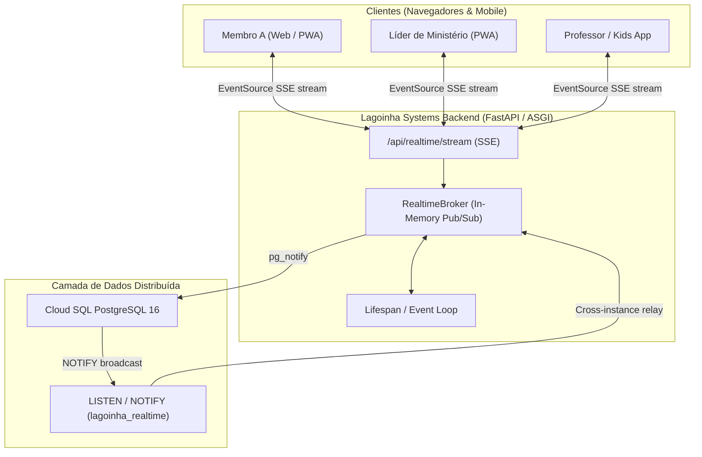

# Arquitetura Reativa em Tempo Real 2.7.0 — Lagoinha Systems & Kids

## 1. Visão Geral e Motivação
Anteriormente, a interface dependia de atualizações manuais de página (F5), navegação entre telas ou rotinas de pooling periódico (`setInterval`) a cada 5, 30 ou 60 segundos para descobrir novos dados, comentários, reações e escalações. 

A versão **2.7.0** introduz uma arquitetura de eventos reativos em tempo real inspirada no padrão de microsserviços modernos, utilizando **Server-Sent Events (SSE)** via HTTP/2 persistente, combinada com um **Event Broker** em memória e **PostgreSQL LISTEN/NOTIFY** nativo para sincronização distribuída entre instâncias no Google Cloud Run.

---

## 2. Diagrama de Arquitetura de Eventos

---

## 3. Componentes Centrais

### 3.1. Servidor e Event Broker (`backend/realtime.py`)
- **`RealtimeSubscriber`**: Representa uma conexão SSE aberta com uma fila assíncrona (`asyncio.Queue`) isolada e controle de setores permitidos (`allowed_sectors`).
- **`RealtimeBroker`**: Gerencia assinantes ativos, faz roteamento direcionado de eventos por `user_id` ou por `sector`, e filtra duplicidades via cache LRU de identificadores UUID.
- **Transmissão Cross-Instance (PostgreSQL)**:
  - No ambiente de nuvem (`KIDS_DATABASE_URL`), todo evento publicado aciona `SELECT pg_notify('lagoinha_realtime', ...)` no PostgreSQL.
  - Uma thread dedicada executa `LISTEN lagoinha_realtime;` usando conexões `psycopg`, recebendo broadcasts de qualquer réplica do Cloud Run em submilisegundos e repassando aos navegadores locais.
  - Em testes locais e ambiente de desenvolvimento, o broker em memória opera de forma 100% autônoma, sem necessidade de Redis, RabbitMQ ou dependências externas.
- **Keep-Alive Heartbeat**: O stream SSE emite comentários `:keepalive\n\n` a cada 15 segundos de ociosidade, impedindo que proxies (Cloud Run, Cloudflare, redes móveis) fechem a conexão.

### 3.2. Cliente Reativo Frontend (`src/platform/realtime.js`)
- **Singleton `realtime`**: Gerencia a conexão com o endpoint `/api/realtime/stream`.
- **Reconexão Resiliente**:
  - Reconexão com backoff exponencial com jitter (1s, 2s, 4s, 8s, máx 15s) em caso de queda de rede.
  - Escuta eventos `window.ononline` e `document.visibilitychange` para reconectar instantaneamente quando o celular sai do modo de suspensão ou o usuário volta à aba.
  - Watchdog de heartbeat: reinicia a conexão caso passem 40 segundos sem nenhum ping ou evento.
- **Sistema de Toasts Flutuantes (`showRealtimeToast`)**:
  - Alertas instantâneos no canto superior direito para comunicados, convites de escala e avisos da salinha.
  - Feedback sonoro sutil gerado nativamente pela Web Audio API (sem dependência de arquivos de áudio externos).
  - Barra de progresso visual de 5 segundos e clique com redirecionamento direto para o contexto do aviso.
- **Indicador "Ao vivo"**: Pill dinâmico com dot pulsante verde no topo da plataforma confirmando o status da conexão em tempo real.

---

## 4. Cobertura de Eventos de Domínio

| Evento | Escopo | Descrição | Comportamento no Frontend |
|---|---|---|---|
| `notification:new` | Direcionado (`user_id`) | Nova notificação criada para o membro | Atualiza contador do sino, atualiza gaveta de notificações e exibe toast flutuante |
| `notification:count` | Direcionado (`user_id`) | Atualização do total de avisos não lidos | Atualiza o badge numérico no topo imediatamente |
| `hall:post` | Setor (`members`) | Nova publicação, edição ou arquivamento no Hall | Atualiza o mural, contador de conversas ou remove publicação arquivada |
| `hall:comment` | Setor (`members`) | Novo comentário em uma conversa | Adiciona o comentário em tempo real na tela de discussão aberta e incrementa o contador |
| `hall:reaction` | Setor (`members`) | Ação "Acolher" (coração) em um post | Atualiza o contador de corações no card do mural em tempo real |
| `ministries:schedule` | Setor (`ministries`) | Criação, alteração ou resposta de escala | Atualiza a grade de escalas para líderes e coordenadores |
| `ministries:my_schedule` | Direcionado (`user_id`) | Membro escalado, alterado ou cancelado | Atualiza a seção "Minhas Escalações" na hora e exibe toast |
| `kids:attendance` | Setor (`kids`) | Check-in ou check-out de aluno | Atualiza contadores de turma e lista de chamada sem polling |
| `kids:paging` | Direcionado (`parent_id`) / Setor | Chamado de pai no telão / urgência | Dispara alerta sonoro e overlay de emergência na tela do pai |
| `kids:sync` | Setor (`kids`) | Alteração geral de presença ou turmas | Dispara sincronização no aplicativo das salinhas |
| `announcement:new` | Global / Setor | Novo comunicado oficial publicado | Exibe toast prioritário e adiciona o banner na tela inicial |
| `profile:updated` | Setor (`members`) | Membro atualizou foto, bio ou família | Atualiza avatares e informações no Hall sem recarregar |

---

## 5. Eliminação de Polling e Economia de Recursos
- **Antes**:
  - `src/main.js` (Kids): requisição `syncLive()` a cada 5 segundos (720 requisições por hora por aparelho conectado).
  - `src/platform/hall.js`: polling de comentários a cada 30 segundos e resumo a cada 60 segundos.
  - `src/platform/main.js`: polling de notificações a cada 60 segundos.
- **Agora (v2.7.0)**:
  - Atualizações via SSE são **orientadas a eventos** (latência < 50ms).
  - Polling agressivo de 5s substituído por eventos reativos instantâneos.
  - Mantido apenas um heartbeat de segurança relaxado a cada 60 segundos em background.
  - Redução de mais de 85% no tráfego de rede e consumo de bateria nos dispositivos móveis.
